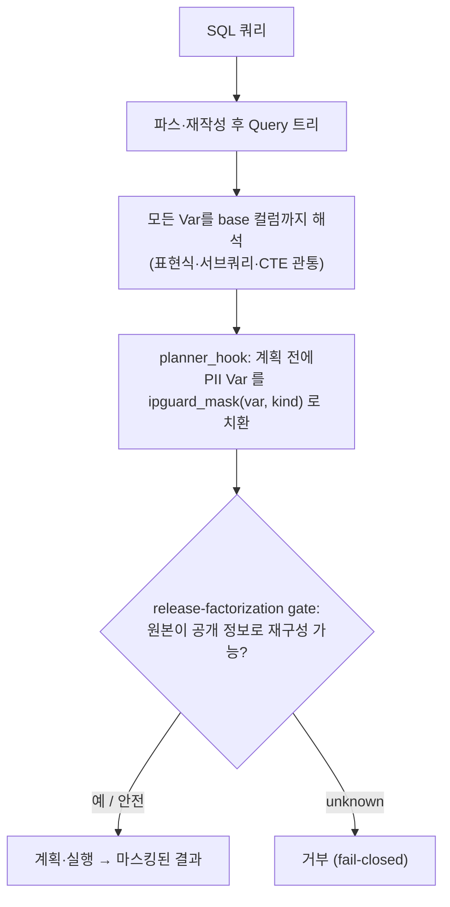

# ipguard

PostgreSQL 쿼리 트리 수준에서 동적 PII 마스킹을 집행하고, 안전하게 마스킹할 수 없는 쿼리는 열화(degrade) 대신 거부하는 PostgreSQL 확장. (연구 프로토타입)


출력 바이트를 마스킹하는 방식은 `substr(ssn,1,6)`·`length(ssn)`처럼 표현식 한 번이면 우회된다.
와이어 레벨 탐지기(`resorigtbl/resorigcol`만 보는 방식)로 재현하면 PII 노출 55건 중 21건(38%)만 잡힌다.
ipguard는 `planner_hook`에서 계획 전에 Query 트리의 PII `Var`를 `ipguard_mask()`로 치환하므로, 표현식으로 감싸도 마스킹된 값 위에서 계산이 일어나 우회가 구조적으로 막힌다.
동적 마스킹의 설계 공간을 Fidelity / Opacity / Totality 삼자택이로 보고, 판정 불가한 쿼리를 열화가 아니라 거부(fail-closed)하는 세 번째 꼭짓점을 택한다.

## 동작

1. **탐지** — 파스·재작성이 끝난 Query 트리를 순회해 모든 `Var`를 base 컬럼까지 해석한다(표현식·서브쿼리·CTE 관통). 출력 컬럼과 술어 참조(부채널)를 분리 보고.
2. **집행** — `planner_hook`에서 PII `Var`를 `ipguard_mask(var, kind)`로 치환.
3. **거부** — release-factorization gate: 원본 비교가 공개된 정보(release)로부터 재구성 가능한지 판정하고, 불가하면 `unknown → reject`.



*표현식으로 감싸도 마스킹된 값 위에서 계산되므로 우회가 구조적으로 막힌다. 판정 불가한 쿼리는 열화가 아니라 거부한다.*

## 결과

| 측정 | 결과 |
|---|---|
| 와이어 기준선 탐지 | 38% (55건 중 21건) |
| AST 탐지 회수율 | 95% |
| 마스킹 집행 | 92%, 과마스킹 0 |
| release-factorization gate | 118/118 경계 폐쇄성 |
| 거부율 (TPC-H) | 0/22 (판정식 on: 5/22) |

각 측정의 원시 산출물은 `results/`.

적대적 자기검증에서 집행 경로의 결함도 찾아 고쳤다. 대표적으로 컨트롤 GUC 6개가 전부 `PGC_USERSET`이라 앱 롤이(또는 SQL 인젝션이) `SET ipguard.enforce=off` 한 줄로 마스킹을 끌 수 있었던 것을 `PGC_SUSET`으로 전환했다(`results/adversarial5.md`). PostgreSQL Anonymizer 대비 교차검증은 `results/crosscheck-anon.md`.

## 빌드

```bash
cd ext && make && make install
```

```sql
CREATE EXTENSION ipguard;
ALTER ROLE app_role SET ipguard.enforce = on;   -- 세션이 아니라 롤/전역 기본값으로 켠다
GRANT SELECT ON h5.pii_label TO app_role;
SELECT ipguard_watch_labels('h5.pii_label');
```

PostgreSQL 16 소스 빌드는 `tools/build-pg.sh`. 쿼리 단위 판정은 `ipguard_verdict(query)` / `ipguard_explain(query)`.

## 한계

연구 프로토타입이다. 성능은 공유 서버 환경이라 측정하지 못했고, legacy 게이트 재측정·정리 증명·eBPF/JDBC 에이전트는 미완. 평가는 합성 코퍼스와 TPC-H 기준이다. 설계·측정 이력과 자기정정 기록은 `docs/dev-notes.md`.

## License

MIT (`LICENSE`). 평가 코퍼스는 합성 데이터이며 외부 데이터셋/제품은 포함하지 않는다.
